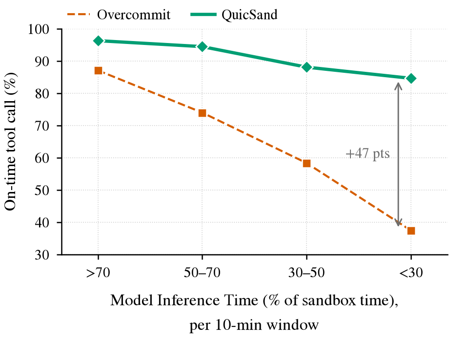
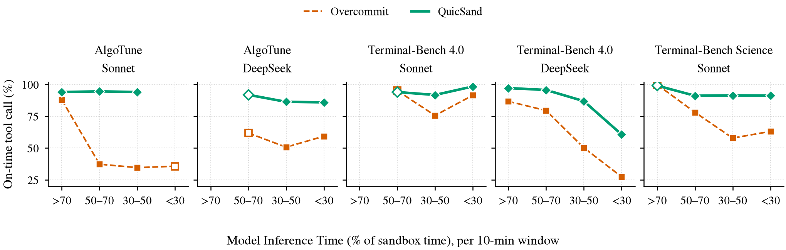

# QuicSand: sensitivity to model inference time

Code, data and figures behind Appendix B of the QuicSand paper ("Sensitivity to Inference Time"). The write-up is in [APPENDIX_B.md](APPENDIX_B.md); this file explains how to reproduce the plots.

## What is measured

Existing TapeBox replay runs are cut into 10-minute windows. For each window we record:

- **On-time tool call (%)**: the share of judged tool calls whose execution time (proxy holds excluded) is at most 1.10x the slowest of five uncontended strict-reservation reruns of the same call, with reference times floored at 1 s.
- **Model Inference Time (% of sandbox time)** (`inference_share`, the x-axis of the figures): time spent between a model request and its last response byte, divided by resident sandbox time, per 10-minute window.

Windows with fewer than 20 judged tool calls are dropped. We compare QuicSand (`quicksand-v6` and `quicksand-v7` pooled) with `overcommit-1.0`, shown as "Overcommit".

## Results

| Model Inference Time (% of sandbox time) | Overcommit | QuicSand |
|---|---|---|
| > 70% | 87% | 96% |
| 50–70% | 74% | 94% |
| 30–50% | 58% | 88% |
| < 30% | 37% | 85% |

On-time tool calls (%), pooled over AlgoTune, Terminal-Bench 4.0 (Sonnet and DeepSeek) and Terminal-Bench Science. Overcommit loses on-time calls as fewer sandboxes are waiting on the model; QuicSand stays at 85–96%.



Per workload (hollow markers: fewer than three 10-minute windows in the bin):



The analysis is observational. A controlled sweep (TapeBox `--speed`) would separate load from latency.

## Layout

```
data/windows.csv       one row per (recording, policy run, 10-min window); 552 rows
scripts/reproduce.sh         runs the whole pipeline
scripts/extract_windows.py   builds windows.csv from TapeBox replay output (needs the raw traces)
scripts/plot_share.py        figures against share of sandbox time waiting on the model
figures/                     the two figures (PDF and PNG) used in Appendix B
APPENDIX_B.md                the paper text and captions
```

`windows.csv` columns: `recording, run, window, inference_share, resident_h, judged, on_time, tool_calls_done, fleet_usd_per_h`. The `fleet_usd_per_h` column is left over from an earlier cost analysis and is unused.

## Reproduce

Requirements: a TapeBox checkout with its virtualenv (tested at commit `1dadbd09fc6b6082fcbef9c8f2fde671e615a632`) and the TapeBox replay traces (about 1.1 TB) under `$TAPEBOX/output/replay/<bench>/<recording>/<policy>/`, including the uncontended reference `strict-ref/strict-speed0`. Fetch the traces from the project's trace bucket, for example `aws s3 sync s3://<bucket>/output/replay $TAPEBOX/output/replay`.

```bash
git clone https://github.com/depetrol/TapeBox
(cd TapeBox && python -m venv .venv && .venv/bin/pip install -e .[host])
export TAPEBOX=$PWD/TapeBox
scripts/reproduce.sh        # traces -> data/windows.csv -> figures/
```

`reproduce.sh` runs `extract_windows.py` on the five recordings (AlgoTune with Sonnet and DeepSeek, Terminal-Bench 4.0 with Sonnet and DeepSeek, Terminal-Bench Science), concatenates the results into `data/windows.csv`, and redraws both figures. Extraction is the slow step (hours on a cold cache; the TapeBox index and analysis caches are written next to the scripts and speed up reruns).

`extract_windows.py` calls TapeBox's `tapecollect.plot.compare` with `--reference-stat max`, a 1.10 threshold and a 1000 ms floor, the on-time definition from TapeBox commit 5a1580d.

To redraw only the figures from the committed CSV, skip the extraction: `$TAPEBOX/.venv/bin/python scripts/plot_share.py` (any Python with `matplotlib` works if `TAPEBOX` points at a TapeBox checkout, which supplies the plot style module).

## Caveats

- The result is observational: windows with few sandboxes waiting on the model also tend to be the most heavily loaded.
- "QuicSand" pools the `quicksand-v6` and `quicksand-v7` runs.
- ScienceAgentBench is excluded because its fleet never saturates.
